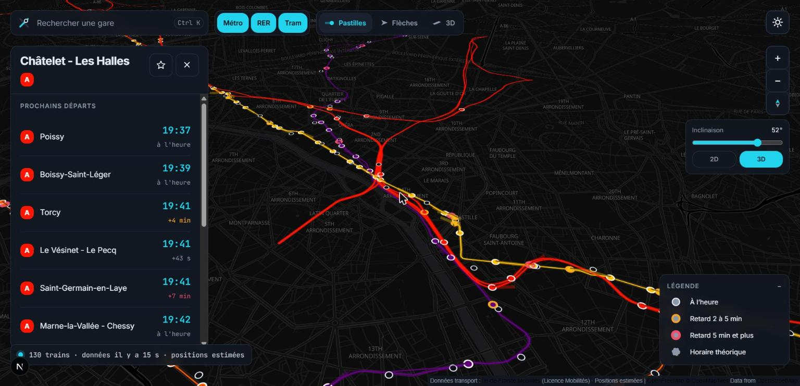
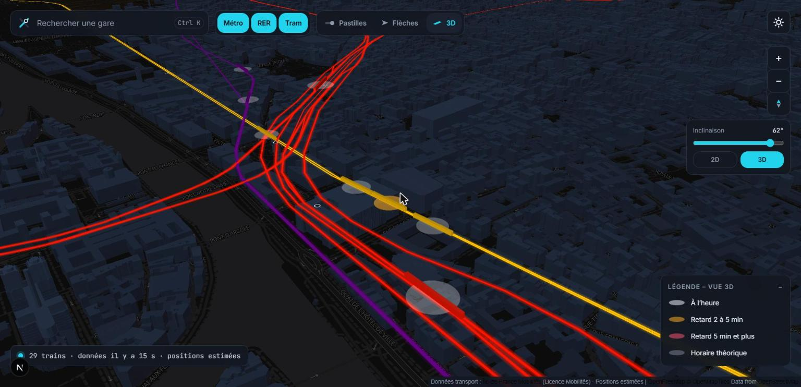
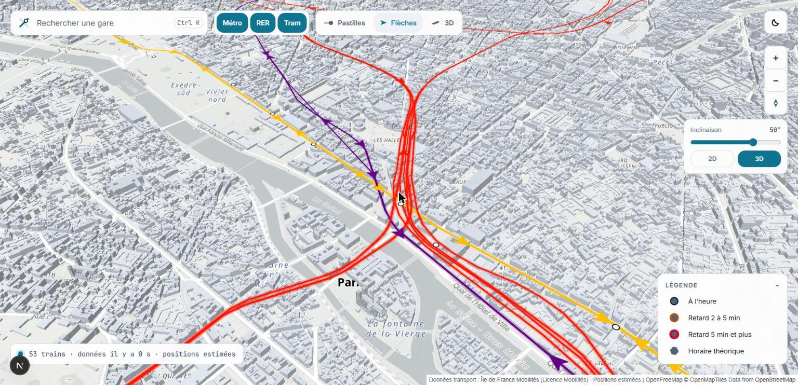

# Système de design – XLiveMetro

> Ambiance **« salle de contrôle »** : sombre, précise, technique. La carte et les couleurs officielles des lignes sont au premier plan ; l'interface s'efface.
> Mise en œuvre : `apps/web/src/app/globals.css` (jetons), `apps/web/src/lib/mapTheme.ts` (carte), `apps/web/src/components/` (composants). Décision : [ADR 0016](docs/adr/0016-rendu-3d-et-design.md).

## Identité

- **Logo** : deux tracés qui se croisent en X (un neutre, un cyan) et un train lumineux sur le tracé cyan. Composant `Logo`, icône `apps/web/src/app/icon.svg`. Couleurs du thème courant (variables CSS).
- **Mot-symbole** : « X**Live**Metro », Inter 700, « Live » en accent.
- Les couleurs des lignes sont les **couleurs officielles IDFM**, jamais modifiées. L'accent cyan a été choisi pour ne se confondre avec aucune ligne.

## Jetons de couleur

Le thème est porté par `<html data-theme="dark|light">` (sombre par défaut, choix enregistré en `localStorage`, appliqué avant le premier rendu). Les classes Tailwind utilisent les jetons (`bg-surface`, `text-muted`, `border-border`…).

| Jeton         | Sombre    | Clair     | Usage                                                |
| ------------- | --------- | --------- | ---------------------------------------------------- |
| `--bg`        | `#0B0F14` | `#F4F6F9` | fond de page                                         |
| `--surface`   | `#121821` | `#FFFFFF` | panneaux, fiches                                     |
| `--surface-2` | `#1A2230` | `#EEF2F6` | survol, éléments imbriqués                           |
| `--border`    | `#263142` | `#D5DCE5` | bordures                                             |
| `--text`      | `#E6EDF5` | `#0E1621` | texte principal                                      |
| `--text-2`    | `#C3CCD8` | `#33404F` | texte secondaire fort                                |
| `--muted`     | `#8B98A9` | `#536173` | libellés, aides (contraste ≥ 4,5:1)                  |
| `--accent`    | `#22D3EE` | `#0E7490` | actions, sélection, chiffres en direct               |
| `--warn`      | `#F5A524` | `#B45309` | retard de 2 à 5 min                                  |
| `--alert`     | `#F0506E` | `#BE123C` | retard de 5 min et plus                              |
| `--overlay`   | 92 %      | 94 %      | barres flottantes sur la carte (flou d'arrière-plan) |

## Typographie

| Usage                                                | Police         | Taille / graisse               |
| ---------------------------------------------------- | -------------- | ------------------------------ |
| Interface, titres                                    | Inter          | 13 à 22 px, 400 à 700          |
| Libellés de section (`.label-caps`)                  | Inter          | 12 px, 600, capitales espacées |
| Chiffres qui changent (attentes, retards, compteurs) | JetBrains Mono | 12 à 18 px                     |

Chargées par `next/font` (auto-hébergées, aucune requête vers Google côté visiteur).

## Formes et espacements

- Rayons : 6 (badges), 10 (boutons, encarts), 14 px (panneaux).
- Espacements : 4, 8, 12, 16, 24, 32 px.
- **Cibles tactiles ≥ 44 px** (`IconButton`).
- Badges de ligne (`LineBadge`) : **rond** pour le métro, **carré** pour le RER, **barre de couleur** pour le tram.

## Les trains sur la carte

Trois représentations au choix (`RepresentationPicker`, préférence en `localStorage`) :

| Représentation     | Rendu                                                                                                                       |
| ------------------ | --------------------------------------------------------------------------------------------------------------------------- |
| Pastilles (défaut) | pastille à la couleur de la ligne, sillage des 30 dernières secondes, anneau de retard                                      |
| Flèches            | flèche orientée selon le sens de circulation (utile sur les troncs communs), 12 px en vue d'ensemble, jusqu'à 30 px de près |
| 3D                 | rames 3D dès le zoom 15 (pastilles au-delà), halo au sol coloré selon le retard                                             |

**Retard** : l'anneau change de couleur **et d'épaisseur** (2 / 3,5 / 5 px) ; il est gris pour un horaire théorique. L'information ne repose jamais sur la couleur seule, et le retard est toujours écrit dans les fiches. En 3D, un anneau se lirait mal en perspective : le halo au sol le remplace. La légende suit la représentation affichée.

**Rames 3D** : une seule géométrie (cube) instanciée pour tous les trains ; une matrice par rame (longueur réelle, largeur et hauteur doublées pour la lisibilité, cap, pose au sol). Coupées si « réduire les animations » est activé (la carte ne s'anime plus).

## La carte

- **Sombre** : style OpenFreeMap « dark », bâtiments extrudés plus clairs en hauteur, lumière froide rasante, horizon brumeux (`setSky`).
- **Clair** : style « positron », bâtiments gris clair, ciel pâle.
- **Lignes** : dessinées par MapLibre, halo diffus + trait fin, **au-dessus** des bâtiments (le métro est souterrain : sous les bâtiments, il disparaîtrait).
- **Commandes** : zoom, nord, curseur d'inclinaison et bascule 2D/3D (`ViewControls`).

## Accessibilité

- Contrastes AA vérifiés pour les jetons de texte dans les deux thèmes.
- Vrais `<button>`, `<input>` et `<label>` ; boutons icônes nommés (`aria-label`), états `aria-pressed`.
- Toute information de la carte existe en texte (fiches, recherche).
- `prefers-reduced-motion` : pas d'interpolation des trains, pas d'animation de caméra.

## Mobile

Sous 640 px : la barre se réduit à la recherche, la fiche gare devient un panneau en bas d'écran ; légende, filtres et commandes de vue sont masqués.
